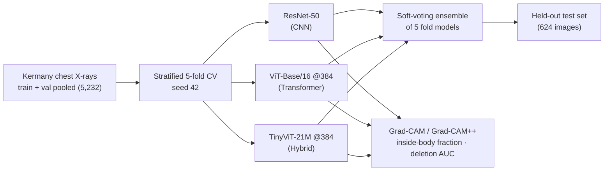
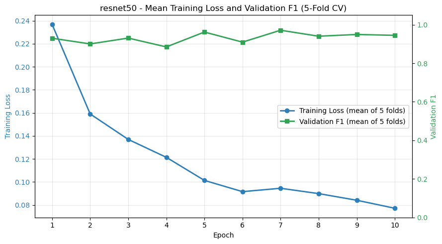
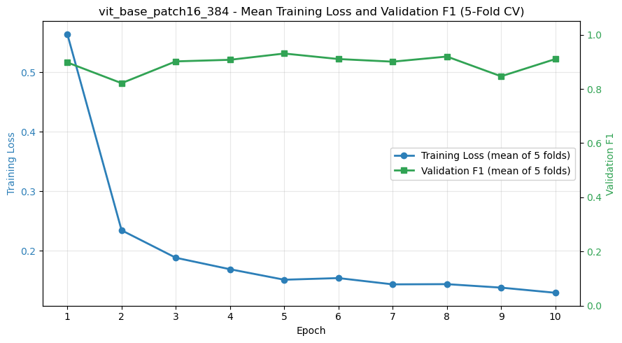
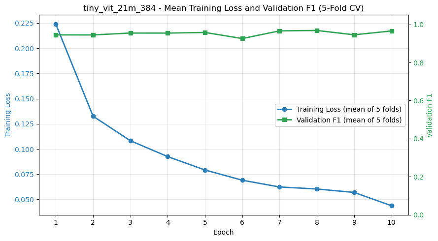
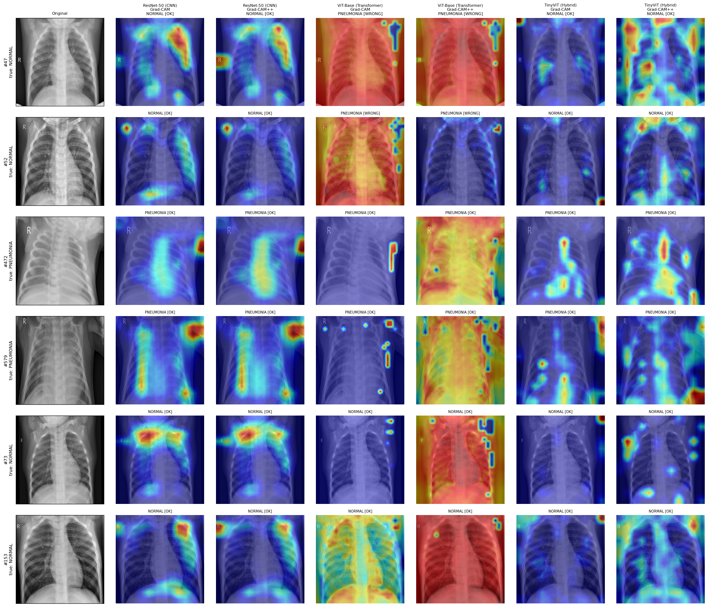
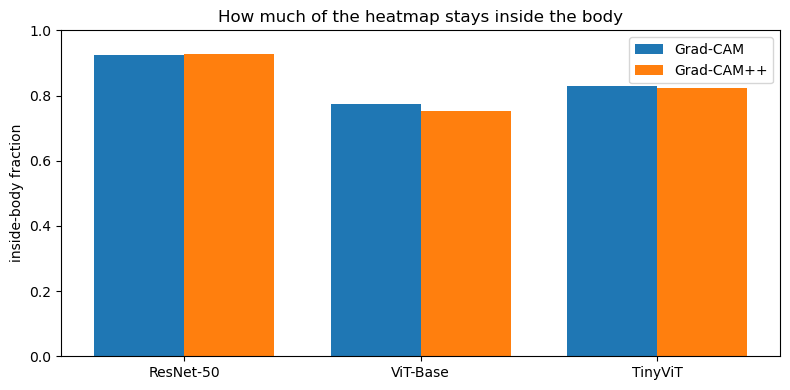

<div align="center">

# Pneumonia Detection: CNN vs ViT vs Hybrid (TinyViT) with Grad-CAM

**ResNet-50, ViT-Base and the CNN-Transformer hybrid TinyViT, trained under identical conditions on chest X-rays
(5-fold CV with a soft-voting ensemble), then compared on accuracy *and* on whether their Grad-CAM heatmaps look
at the lungs.**

[](#setup)
[](#method)
[](#explainability-grad-cam)
[](LICENSE)

[📄 Report (PDF)](docs/report.pdf) · [📓 Notebooks](notebooks) · [📊 Raw results](results)

*Deep Vision · M.Sc. Artificial Intelligence for Industrial Applications · OTH Amberg-Weiden ·
Supervisor: Prof. Dr. Tatyana Ivanovska · Summer Semester 2026*

</div>

---

## TL;DR

| Model | Type | Params | Test accuracy | Test F1 | NORMAL recall | PNEUMONIA recall | Grad-CAM inside body ↑ | Deletion AUC ↓ |
|---|---|:---:|:---:|:---:|:---:|:---:|:---:|:---:|
| ResNet-50 | CNN | 23.5 M | 93.6 % | 0.935 | 83.8 % | **99.5 %** | **0.925** | **0.532** |
| ViT-Base/16 | Transformer | 86.1 M | 92.8 % | 0.927 | 83.8 % | 98.2 % | 0.775 | 0.794 |
| **TinyViT-21M** | **Hybrid** | **20.7 M** | **94.9 %** | **0.948** | **87.2 %** | **99.5 %** | 0.829 | 0.621 |

- **TinyViT is the most accurate** and has the fewest parameters. It also has the most stable folds
  (CV F1 0.979 ± 0.002).
- **ResNet-50's heatmaps are the most trustworthy.** They stay inside the body most often and score best on the
  deletion test.
- **ViT-Base is the weakest on both counts.** It is the largest model, but has the lowest accuracy, the most
  heatmap attention outside the body and the least faithful heatmaps.
- Every model misses NORMAL cases far more often than PNEUMONIA ones (84–87 % against 98–99.5 % recall), so they
  lean towards predicting pneumonia.

Test-set numbers come from the 5-fold soft-voting ensemble on the **held-out Kermany test set** (624 images), which
was never used for training or model selection. The last two columns are plain Grad-CAM scores; Grad-CAM++ results
are in the [explainability section](#explainability-grad-cam).

## Research questions

1. How do a CNN, a Vision Transformer and a CNN-Transformer hybrid compare for pneumonia detection when trained
   under **identical** conditions?
2. Do their Grad-CAM heatmaps focus on **clinically relevant regions**, and how faithful are those explanations?

## Dataset

[Chest X-Ray Images (Pneumonia)](https://www.kaggle.com/datasets/paultimothymooney/chest-xray-pneumonia), from
Kermany et al. (2018): 5,856 paediatric chest X-rays labelled NORMAL or PNEUMONIA.

| Split | NORMAL | PNEUMONIA | Total | Used for |
|---|:---:|:---:|:---:|---|
| `train/` + `val/` (pooled) | 1,349 | 3,883 | 5,232 | 5-fold stratified CV (about 4,186 train / 1,046 val per fold) |
| `test/` | 234 | 390 | 624 | final evaluation only |

The original `val/` split has only 16 images, so it is pooled with `train/`, and the folds provide proper
validation sets.

## Method



| Setting | Value |
|---|---|
| Backbones | `timm` ImageNet-pretrained `resnet50`, `vit_base_patch16_384`, `tiny_vit_21m_384`, each with a 2-class head |
| Input | 384 × 384, ImageNet normalisation |
| Augmentation | horizontal flip, RandomResizedCrop (0.8–1.0), colour jitter, ±10° rotation, 5 % translation |
| Optimiser | AdamW, weight decay 0.01. Learning rate **1e-3** (ResNet-50), **1e-4** (ViT-Base, TinyViT) |
| Loss | cross-entropy with class weights computed on each fold's training split |
| Training | 10 epochs per fold, batch size 16, mixed precision (FP16). The best epoch per fold is chosen by validation F1 |
| Ensemble | probabilities averaged over the 5 fold checkpoints |
| Hardware | single NVIDIA RTX 2080 SUPER (8 GB). Total training time: 29 min (ResNet-50), 68 min (ViT-Base), 45 min (TinyViT) |

### Training curves

<p align="center">
  
  
  
</p>

| Model | Best validation F1 per fold | Mean ± SD |
|---|---|:---:|
| ResNet-50 | 0.988 · 0.971 · 0.974 · 0.985 · 0.969 | 0.977 ± 0.009 |
| ViT-Base | 0.952 · 0.960 · 0.954 · 0.917 · 0.944 | 0.945 ± 0.017 |
| TinyViT | 0.978 · 0.977 · 0.979 · 0.982 · 0.978 | **0.979 ± 0.002** |

### Confusion matrices on the test set (rows = true class, columns = predicted class)

| | ResNet-50 | ViT-Base | TinyViT |
|---|:---:|:---:|:---:|
| NORMAL → NORMAL / PNEUMONIA | 196 / 38 | 196 / 38 | **204 / 30** |
| PNEUMONIA → NORMAL / PNEUMONIA | 2 / 388 | 7 / 383 | 2 / 388 |

## Explainability (Grad-CAM)

Grad-CAM and Grad-CAM++ heatmaps come from a representative fold model of each architecture:

| Model | Target layer |
|---|---|
| ResNet-50 | `layer4[-1]` |
| ViT-Base | `blocks[-1].norm1`, with tokens reshaped to a 24 × 24 grid |
| TinyViT | `stages[-1].blocks[-1].local_conv` |

<p align="center"></p>

Two quantitative scores measure the heatmaps:

- **Inside-body fraction (↑):** the share of heatmap energy that falls inside the body, as opposed to the image
  border or labels. A higher value means the model is looking in the right place. It is averaged over 200 test
  images (100 NORMAL, 100 PNEUMONIA).
- **Deletion AUC (↓):** the most important pixels are removed first. If the prediction collapses quickly, the
  heatmap really reflects what the model relies on. It is computed on a balanced 60-image subset.

| Model | Inside-body Grad-CAM | Inside-body Grad-CAM++ | Deletion AUC Grad-CAM | Deletion AUC Grad-CAM++ |
|---|:---:|:---:|:---:|:---:|
| ResNet-50 | **0.925** | **0.928** | **0.532** | **0.548** |
| ViT-Base | 0.775 | 0.752 | 0.794 | 0.768 |
| TinyViT | 0.829 | 0.824 | 0.621 | 0.649 |

<p align="center"></p>

**Reading the results:** the convolutional inductive bias gives ResNet-50 compact, anatomically plausible
heatmaps. ViT-Base spreads its attention widely, including outside the body, and its heatmaps are the least
faithful. TinyViT, which uses convolutions in its early stages, sits between the two while being the most
accurate model.

## Repository structure

```
.
├── src/
│   ├── data.py         # dataset, transforms, stratified k-fold loaders (DATA_ROOT = ../Dataset/chest_xray)
│   ├── train.py        # build_model (timm), class weights, train_one_fold with AMP
│   ├── ensemble.py     # soft-voting ensemble over fold checkpoints + test metrics
│   └── xai.py          # Grad-CAM / Grad-CAM++ target layers and reshape transforms
├── notebooks/          # run in order; each one adds ../src to sys.path
│   ├── 01_resnet50.ipynb
│   ├── 02_vit_base.ipynb
│   ├── 03_tinyvit.ipynb
│   └── 04_gradcam_analysis.ipynb
├── results/            # k-fold histories, test metrics, Grad-CAM image sets and scores (JSON)
├── docs/
│   ├── report.pdf
│   └── figures/
├── requirements.txt
└── LICENSE
```

## Setup

```bash
git clone https://github.com/SomanthaManuranga/pneumonia-cnn-vit-hybrid-comparison.git
cd pneumonia-cnn-vit-hybrid-comparison
python -m venv .venv && source .venv/bin/activate   # Windows: .venv\Scripts\activate
pip install torch torchvision --index-url https://download.pytorch.org/whl/cu121   # pick your CUDA version
pip install -r requirements.txt
```

Download the [Kaggle dataset](https://www.kaggle.com/datasets/paultimothymooney/chest-xray-pneumonia) and unpack it
so the folders look like this (the `Dataset/` folder is git-ignored):

```
Dataset/chest_xray/{train,val,test}/{NORMAL,PNEUMONIA}/*.jpeg
```

## Reproducing the results

You need a CUDA GPU with at least 8 GB of VRAM. Run the notebooks from the `notebooks/` folder, top to bottom:

1. `01_resnet50.ipynb`, `02_vit_base.ipynb` and `03_tinyvit.ipynb` train 5 folds each. They save the checkpoints to
   `checkpoints/` (git-ignored, about 0.1–0.35 GB per model per fold) and the metrics to
   `results/<model>_kfold_results.json`.
2. `04_gradcam_analysis.ipynb` loads one fold checkpoint per model and the image sets in
   `results/phase2_image_sets.json`, then writes the heatmap grid and `results/phase2_xai_summary.json`.

Seeds are fixed (42), but GPU non-determinism can still shift the numbers slightly between runs.

## Limitations

- **One dataset from one hospital** of paediatric patients; generalisation to adult or multi-centre X-rays is untested.
- **NORMAL recall is the weak point** (84–87 %). In clinical use this means more false alarms.
- The Grad-CAM metrics come from one representative fold per model, on a selected image set.
- The "inside-body" mask is an intensity-threshold heuristic, not an expert lung segmentation.

## References

- D. S. Kermany et al., *Identifying Medical Diagnoses and Treatable Diseases by Image-Based Deep Learning*, Cell, 2018.
- K. He et al., *Deep Residual Learning for Image Recognition*, CVPR 2016.
- A. Dosovitskiy et al., *An Image is Worth 16x16 Words: Transformers for Image Recognition at Scale*, ICLR 2021.
- K. Wu et al., *TinyViT: Fast Pretraining Distillation for Small Vision Transformers*, ECCV 2022.
- R. R. Selvaraju et al., *Grad-CAM: Visual Explanations from Deep Networks via Gradient-based Localization*, ICCV 2017.
- A. Chattopadhay et al., *Grad-CAM++: Generalized Gradient-Based Visual Explanations*, WACV 2018.

## License

The code is released under the [MIT License](LICENSE). The dataset is subject to its own licence
([CC BY 4.0](https://data.mendeley.com/datasets/rscbjbr9sj/2)).
